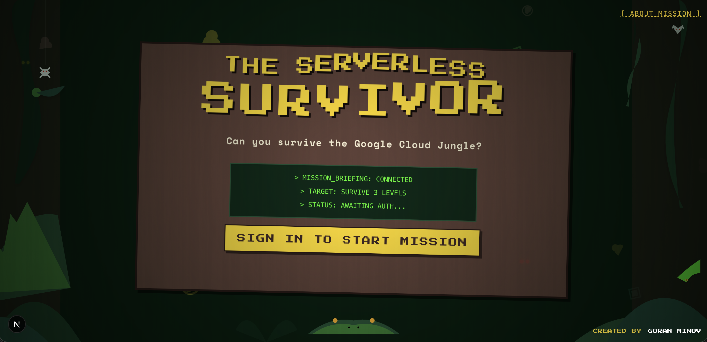
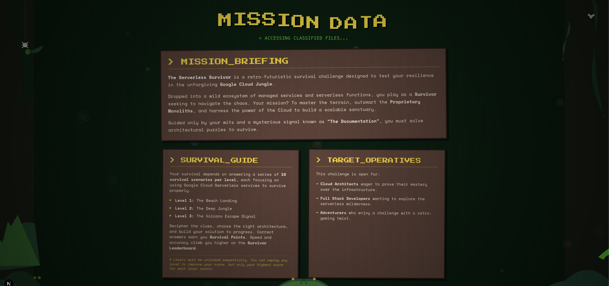
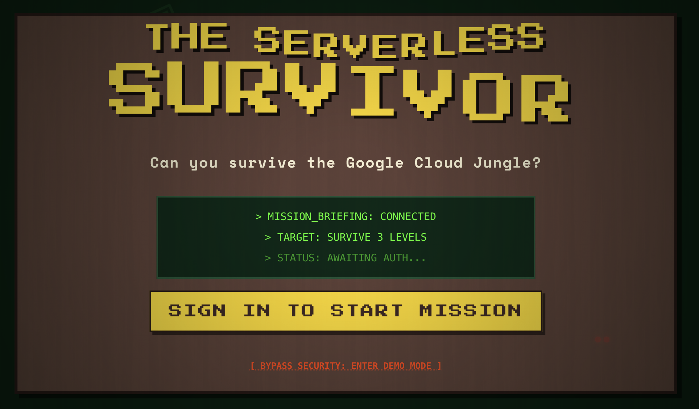

# The Serverless Survivor

**🔴 Live Demo: [survivor.lineargs.dev](https://survivor.lineargs.dev)**



**The Serverless Survivor** is a retro-futuristic survival quiz game built on Google Cloud. Players navigate the "Google Cloud Jungle," answering 10 survival scenarios per level to unlock new challenges and climb the survivor leaderboard.

**Theme:** 🏝️ Retro 8-bit Jungle meets Cloud Architecture.

---

## 🚀 Getting Started

### Prerequisites

- Node.js 18+
- npm or yarn

### Installation

1.  **Clone the repository:**

    ```bash
    git clone https://github.com/your-username/serverless-survivor.git
    cd serverless-survivor
    ```

2.  **Install dependencies:**

    ```bash
    npm install
    # or
    yarn install
    ```

3.  **Set up Environment Variables:**
    Copy `.env.example` to `.env.local` and add your Firebase configuration.

    ```bash
    cp .env.example .env.local
    ```

4.  **Run the development server:**

    ```bash
    npm run dev
    ```

    Open [http://localhost:3000](http://localhost:3000) with your browser to see the result.

---

## 🛠️ Project Structure

```
.
├── src/
│   ├── app/                # Next.js App Router pages
│   │   ├── page.tsx        # Home / Landing Page
│   │   ├── about/          # About Page (Mission Data)
│   │   ├── game/           # Main Game Logic
│   │   └── leaderboard/    # Leaderboard Display
│   ├── components/         # Reusable UI Components
│   │   ├── SignInModal.tsx # Google Auth Modal
│   │   ├── JungleAtmosphere.tsx
│   │   └── ...
│   ├── context/            # Global State (AuthContext)
│   └── lib/                # Firebase & Helper functions
```

---

## ☁️ Deployment

This project is deployed using **Firebase App Hosting**, a serverless web hosting solution optimized for Next.js.

### The Stack

- **Frontend**: Next.js (App Router)
- **Backend**: Cloud Firestore (Database), Vertex AI (Question Generation)
- **Auth**: Firebase Authentication
- **Hosting**: Firebase App Hosting

### Configuration (`apphosting.yaml`)

We use `apphosting.yaml` to define runtime settings and environment variables.

**Mock Layout:**

```yaml
runConfig:
  cpu: 1
  memoryMiB: 2048
  minInstances: 0 # Scale to zero when idle
  maxInstances: 10
  concurrency: 80

env:
  - name: NEXT_PUBLIC_FIREBASE_API_KEY
    value: "YOUR_API_KEY"
  - name: NEXT_PUBLIC_FIREBASE_PROJECT_ID
    value: "your-project-id"
  - name: NEXT_PUBLIC_FIREBASE_AUTH_DOMAIN
    value: "your-project.firebaseapp.com"
  # ... other Firebase config
```

### Manual Deployment

If configured with GitHub integration, pushing to `main` triggers a rollout. To deploy manually via CLI:

```bash
firebase deploy --only apphosting
```

---

## 🎮 Gameplay Mechanics



- **Levels**: 3 Unique Levels (Beach, Jungle, Volcano).
- **Questions**: 10 Scenarios per level.
- **Rules**: Sequential unlocking. Replay allowed (Highest score kept).
- **Demo Mode**: There is a hidden "Demo" button on the landing page that reveals itself on hover, allowing users to experience the game mechanics without signing in.



### Dynamic Content Architecture

This application acts as a consumer of content managed via **Cloud Firestore**.

- **Generative Backend**: The questions are generated by an external process using **Vertex AI (Gemini)**. This ensures that the "survival scenarios" are always fresh and thematically consistent.
- **Data Pipeline**: The generated content is validated and pushed to the Firestore `questions` collection.
- **Decoupling**: By decoupling content generation from the frontend, the game can receive new levels and scenarios without requiring a new application deployment.

### Question Generation Prompt (Example)

Questions are generated using **Vertex AI** with a structured prompt. This ensures variety and adherence to the survival theme.

```javascript
// scripts/prompt.js (Snippet)
return `You are the "Island Overseer"...
The Scenario:
Players are stranded on a deserted, overgrown island. They rely solely on lightweight, event-driven, on-demand tools.

Strict Constraints:
- Every question must focus only on Google Cloud Serverless portfolio.
- Length Constraint: Question text restricted to 3-4 sentences.
- Thematic Formatting: "The Beach Landing", "The Deep Jungle", etc.

Required Output Format:
[
  {
    "text": "The thematic survival scenario...",
    "options": ["A", "B", "C", "D"],
    "correctIndex": <0-3>, // Randomized
    "explanation": "A thematic explanation..."
  }
]`;
```

---

## 📚 Educational Resources

Learn more about the technologies powering this project:

- **Next.js**: [The React Framework for the Web](https://nextjs.org/)
- **Firebase**: [App Development Platform](https://firebase.google.com/)
- **Vertex AI**: [Generative AI on Google Cloud](https://cloud.google.com/vertex-ai)
- **Cloud Run**: [Serverless Container Platform](https://cloud.google.com/run)
- **Tailwind CSS**: [Utility-First CSS Framework](https://tailwindcss.com/)

### Building Operational Tools

If you are interested in building similar backend scripts to manage your own content, check out:

- **Firebase Admin SDK**: [Server-side Node.js integration](https://firebase.google.com/docs/admin/setup)
- **Vertex AI Node.js SDK**: [Integrate Gemini into your code](https://docs.cloud.google.com/nodejs/docs/reference/aiplatform/latest)
- **Cloud Scheduler**: [Automate content updates](https://cloud.google.com/scheduler)
